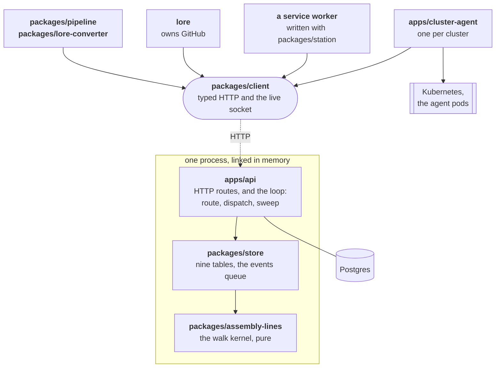
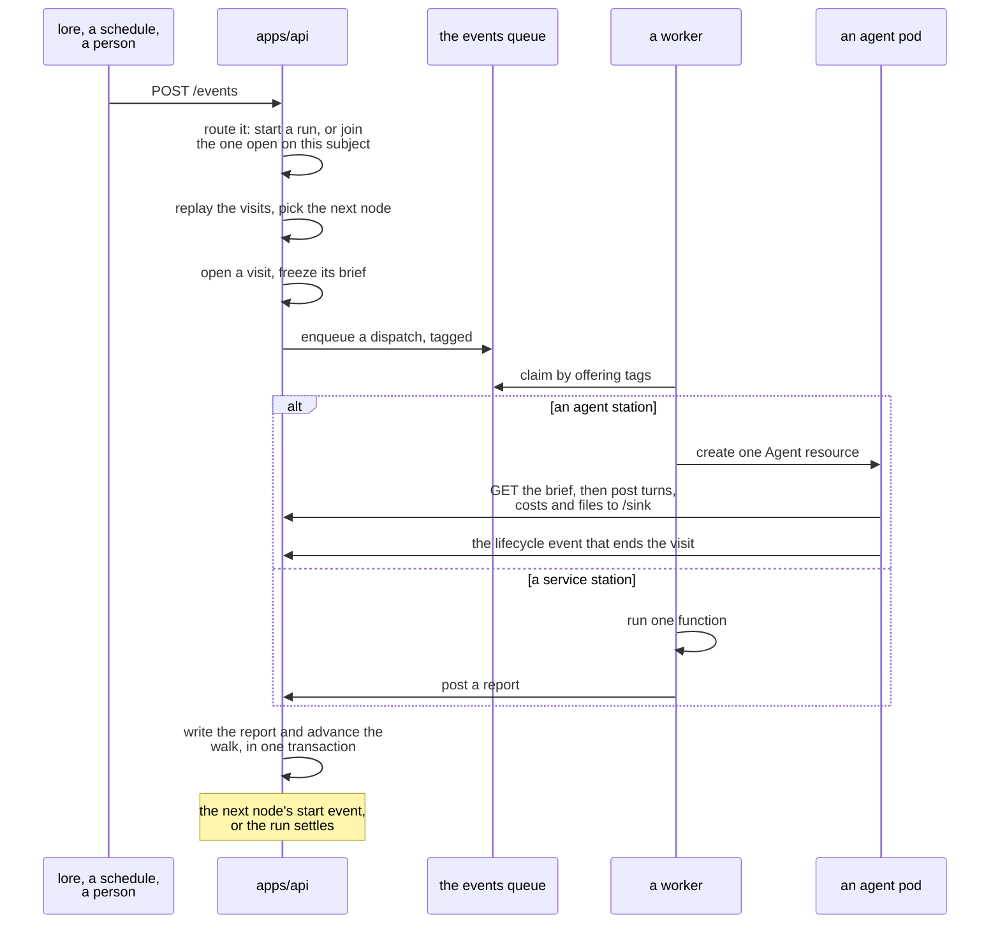

# floor

A workflow engine for pipelines of AI agents. The model rests on two terms that mean different things.

- An **assembly line** is a definition. It is a graph of **nodes** and the edges between them, stored and versioned by its own content. It describes work and never does any.
- An **assembly run** is one execution of one assembly line. Walking it opens a **visit** at each node it reaches, and a visit is worked by an agent in a pod, by a service worker, or by a person.

One assembly line has many assembly runs. Floor stores the definitions, decides what happens next and hands the work out. It does none of the work itself.

Vocabulary, from lore's ADR-024: `Factory ⊃ Floor ⊃ AssemblyLine ⊃ Station ⊃ Agent`.

## Three invariants the whole design hangs on

- Floor holds no provider client. No Kubernetes, no GitHub, no chat. Anything provider-shaped is a station or a separate app.
- Floor never calls out. Every worker pulls its own work from the queue. The one deliberate exception is a pod's git credential, because git waits thirty seconds for an answer.
- No code of ours runs inside an agent pod. The [ai-agent-subsystem](https://github.com/re-cinq/ai-agent-subsystem)'s supervisor does that work.

A fourth is about state. Visits are the truth, and events are how they change. An assembly run's status, its bag, its current node and its cost are all derived by replaying its visits. None of them is stored.

## The map



A solid arrow is a dependency linked in memory, and a dashed one is HTTP. No arrow points out of the api, because every worker calls in.

Only `apps/api` links the store. A worker cannot reach the database even by accident, so the queue is the only way in. A worker can live in another repository, another language or another cluster without floor knowing.

## How an assembly run goes



1. Something posts an event to `POST /events`. It can be a webhook feeder, a schedule tick or a person.
2. The loop routes it. One api replica holds a Postgres advisory lease and runs the loop, and every replica still serves HTTP. The event starts an assembly run, or joins the run already open on its subject.
3. The walk picks the next node by replaying the run's visits. This is pure code in `assembly-lines`. The assembly line says what may happen, and the run's own visits decide what happens next.
4. A visit opens and its brief is frozen at that moment. Each need is resolved from the run's bag, the station and agent definition are pinned by content hash, and a deadline is set.
5. A dispatch goes on the queue, tagged. Nothing is pushed. Workers claim by offering tags.
   - `kind:agent`: `apps/cluster-agent` claims it and creates one Agent resource. The subsystem runs the pod, and the pod posts what it does back to `/station-runs/:id/sink`.
   - `station:<name>`: a service worker claims it, works and posts a report.
   - A human node dispatches nothing and waits with no deadline. Floor serves no page for it. Whoever maintains the station builds that, and answers with a report or an event.
   - A node with no station is a marker. It opens and reports success in one transaction.
6. A report lands, and in the same transaction the walk advances. Either the next node's start event is written or the run settles.

The bag is the only channel between nodes, and it is write-forward only. A node declares what it `needs` and what it `produces`. Floor moves the bytes and nothing else crosses.

## The pieces

| piece | what it is |
|---|---|
| [`apps/api`](apps/api/README.md) | The HTTP API and the single-leased loop. The only process that touches Postgres. |
| [`apps/cluster-agent`](apps/cluster-agent/README.md) | The only process that talks to one cluster's Kubernetes API. Turns a dispatch into an agent pod. |
| [`packages/store`](packages/store/README.md) | Nine tables, the definitions store, the events queue, and the run store. |
| [`packages/assembly-lines`](packages/assembly-lines/README.md) | The assembly line rules, pure and with no I/O. They say which edge is taken next, whether a line is valid and what a prompt is given. Published as `@re-cinq/floor-assembly-lines`. |
| [`packages/contracts`](packages/contracts/README.md) | The floor's wire, as types, with no runtime and no dependencies. The server, its store and every client share one declaration. |
| [`packages/client`](packages/client/README.md) | The floor over HTTP and its live socket, typed. What anything outside a floor reaches it through. |
| [`packages/station`](packages/station/README.md) | The SDK a service station is written with. It is one function and the claim loop around it. |
| [`packages/pipeline`](packages/pipeline/README.md) | A whole pipeline as one file, exported from or imported into a floor over HTTP. |
| [`packages/studio`](packages/studio/README.md) | A local page for a collection folder. It draws each assembly line, explains each station, edits prompts and settings, and runs one agent station with your own `claude` or `codex`. Published as `@re-cinq/floor-studio`. |
| [`packages/lore-converter`](packages/lore-converter/README.md) | Reads a lore checkout and writes the definitions this floor runs in its place. |
| [`plugins/floor`](plugins/floor) | The Claude Code plugin. Its three skills write and check a collection's assembly lines and agent prompts. Listed by the marketplace in [`.claude-plugin`](.claude-plugin/marketplace.json). |
| [`deploy/chart`](deploy/chart/README.md) | One Helm chart, one image, both apps, toggled. |
| [`.github/workflows`](.github/workflows) | CI on every pull request, an image built and pushed on `main`, and a release on a `v*` tag. Argo CD deploys `main` to re:cinq's cluster, see [`deploy/chart`](deploy/chart/README.md#how-recinq-deploys-it). |

GitHub is not in this repository. lore owns it. lore posts GitHub's events to `/events`, runs a service station for every GitHub action an assembly line takes, and answers floor's git-credential request. Floor's own GitHub app was deleted, see [docs/decisions.md](docs/decisions.md), "GitHub".

## Getting started

The documentation is at https://re-cinq.github.io/floor/. It covers what floor is, the tutorials, the specifications of the pipeline file, the agent file and the collection, and the references.

To design a workflow, start with a product decision you can trace on paper. [Define your first assembly line](https://re-cinq.github.io/floor/tutorials/define-a-launch-approval/) turns a launch approval into a complete YAML file. [Add a second sign-off](https://re-cinq.github.io/floor/tutorials/add-a-launch-review/) changes it so two teams must sign off.

To write a collection with Claude Code, install the floor skills. They create and edit assembly lines and agent prompts in your collection's files, lint after every change, and apply to a floor only when you ask. See [The floor skills](https://re-cinq.github.io/floor/reference/skills/).

```
claude plugin marketplace add re-cinq/floor --sparse .claude-plugin plugins/floor
claude plugin install floor@floor
```

To look at a collection in the studio, point the command at the folder. It prints a url and opens it in your browser. `examples/cookbook` in this repository is a collection to try it on. See the [studio README](packages/studio/README.md) for the options and the Run tab.

```
npx @re-cinq/floor-studio path/to/collection
```

To see an assembly run on your machine, follow [Run floor and walk your first line](https://re-cinq.github.io/floor/tutorials/first-run/). To install on a cluster, see [Install on a cluster](https://re-cinq.github.io/floor/reference/install/). For a first agent run there, follow the [installation and first run tutorial](docs/tutorial.md).

Every [release](https://github.com/re-cinq/floor/releases) publishes the chart at `oci://ghcr.io/re-cinq/charts/floor`, the image at `ghcr.io/re-cinq/floor` for `linux/amd64` and `linux/arm64`, and seven npm packages, all under one version.

To work on floor itself:

```
npm install
npm run db:up && npm run db:migrate    # Postgres on :5433
npm run build                          # before npm test: cross-package tests read dist
npm test && npm run typecheck && npm run lint
npm start                              # the dev loop, see docs/dev_loop.md
```

`scripts/walk-*.sh` walk a real run end to end against minikube.

## The documents

[docs/README.md](docs/README.md) is the index. It states the contract the pages keep: they describe the floor as it runs, anything designed but unwritten is marked **Not built yet**, and nothing unmarked should be false. Start with [docs/assembly_run_storage.md](docs/assembly_run_storage.md) for the model, [docs/api_sketch.md](docs/api_sketch.md) for the endpoints, and [docs/decisions.md](docs/decisions.md) for why any of it is the way it is. The [installation tutorial](docs/tutorial.md) covers cluster registration, importing an assembly line and starting an assembly run.
