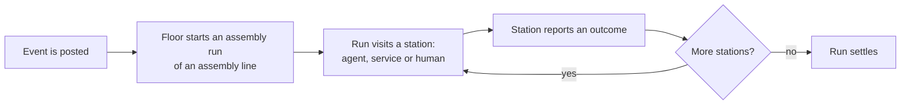

Floor stores assembly lines and decides what happens next. An assembly line is the versioned definition of your work. An assembly run is one execution of it.

An event starts an assembly run. The run visits stations, and an agent, a service or a person works each one. Floor hands out the work and does none of it.

You can read the code and the design notes in the [floor repository](https://github.com/re-cinq/floor).

