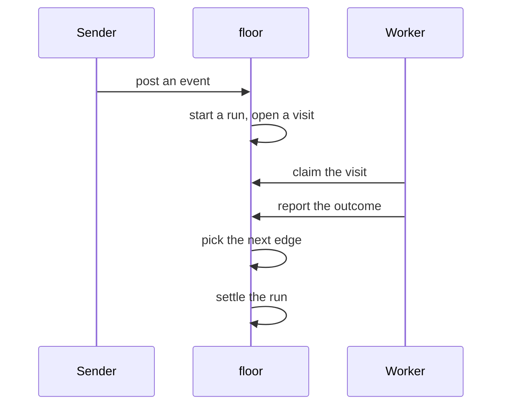

Floor stores assembly lines, decides what happens next in each assembly run, and hands the work out. It does none of the work itself.

## Three rules

| Rule | What it means for you |
| --- | --- |
| Floor holds no provider client | No Kubernetes, no GitHub, no chat. Anything provider-shaped is a station or a separate app. |
| Floor never calls out | Workers pull their own work from a queue. Nothing you run needs to be reachable from floor. The one exception is a git credential, which floor asks an address you configure for. |
| No floor code runs in an agent pod | The pod runs the agent, and reaches floor only over HTTP. |

## From event to settled run

1. Something posts an [event](/floor/concepts/events/) to floor.
2. The event starts an [assembly run](/floor/concepts/assembly-run/) of an [assembly line](/floor/concepts/assembly-line/), or joins the run already open on its subject.
3. Floor opens a visit at the first node and freezes its brief from the run's [bag](/floor/concepts/bag/).
4. A worker claims the visit, does the work and posts a report.
5. Floor writes the report, picks the edge for its outcome and opens the next visit.
6. The run settles at the exit or the fail node.

## The pieces

| Piece | Page |
| --- | --- |
| A versioned definition of nodes and edges | [Assembly line](/floor/concepts/assembly-line/) |
| One execution of a line | [Assembly run](/floor/concepts/assembly-run/) |
| A unit of work, done by an agent, a service or a person | [Station](/floor/concepts/station/) |
| The model, prompt and image behind an agent station | [Agent definition](/floor/concepts/agent-definition/) |
| What you post, and what floor posts back | [Events](/floor/concepts/events/) |
| Lines and agents as files in a folder | [Collection](/floor/concepts/collection/) |
| Every term in one table | [Glossary](/floor/concepts/glossary/) |

The files are specified in [Pipeline file](/floor/specs/pipeline-file/) and [Run semantics](/floor/specs/run-semantics/). The source is at https://github.com/re-cinq/floor.
