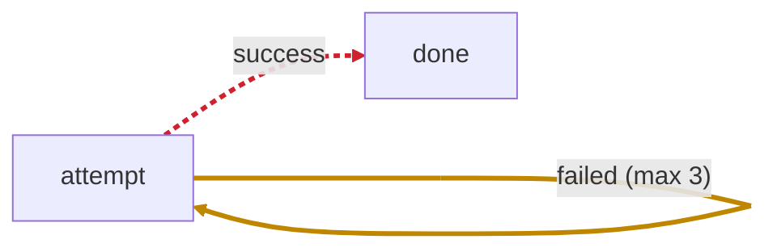
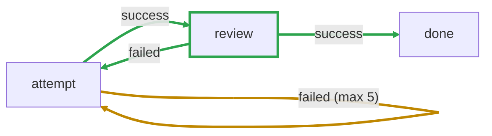

At the end, every pull request to your collection's repository is [linted](/floor/specs/collection/#4-checking-a-collection). One that changes an assembly line also gets a comment that draws each line it touches, as it was and as the pull request would leave it. A new push updates that comment in place, and a pull request that touches no line gets none.

Save the workflow as `.github/workflows/pack-check.yml`. It checks out the pull request and its base side by side, lints the first, and compares the two.

```yaml
name: Pack check

on:
  pull_request:

permissions:
  contents: read
  pull-requests: write

concurrency:
  group: pack-check-${{ github.event.pull_request.number }}
  cancel-in-progress: true

jobs:
  check:
    runs-on: ubuntu-latest
    steps:
      - uses: actions/checkout@v4
        with:
          path: head
      - uses: actions/checkout@v4
        with:
          ref: ${{ github.event.pull_request.base.sha }}
          path: base
      - uses: actions/setup-node@v4
        with:
          node-version: 22
      - name: Lint, and draw what the pull request changes
        run: npx @re-cinq/floor-pipeline lint head --graph-against base > report.md
      - name: Post the drawing, or update the comment already there
        if: github.event.pull_request.head.repo.full_name == github.repository
        env:
          GH_TOKEN: ${{ github.token }}
          PULL_REQUEST: ${{ github.event.pull_request.number }}
          MARKER: "<!-- floor-pack-graph -->"
        run: |
          comments="repos/$GITHUB_REPOSITORY/issues/$PULL_REQUEST/comments"
          existing=$(gh api "$comments" --paginate --jq '.[] | select(.body | startswith(env.MARKER)) | .id' | sed -n 1p)
          if [ -s report.md ]; then
            body=$(cat report.md)
          else
            body="$MARKER"$'\n'"No assembly line changes in this pull request."
          fi
          if [ -n "$existing" ]; then
            gh api --method PATCH "repos/$GITHUB_REPOSITORY/issues/comments/$existing" -f body="$body"
          elif [ -s report.md ]; then
            gh api --method POST "$comments" -f body="$body"
          fi
```

Open a pull request that adds a node, rewires an edge and raises a retry cap. The comment shows each touched line twice, before and with the pull request applied.

**retry-loop** · before



**retry-loop** · proposed changes



Green is added, red and dashed is removed, amber is changed. An edge with a cap shows it in its label. A new line shows only the second graph, and a deleted line only the first.

Push a commit that undoes every line change. The same comment is rewritten to say there are none.

Good to know:

- A refused collection fails the job, and the comment stays as the last good push left it.
- Only a line's `assembly-line.yaml` is drawn. A pull request that edits an agent's prompt draws nothing, and the diff shows it.
- When the base side is refused, the log says `no change report` and nothing is posted.
- A comment may not pass GitHub's limit of 65,536 characters. A pull request that changes so many lines draws as many as fit, in order, and names the rest in a note.
- A pull request from a fork has a read-only token, so only the lint runs.
- Keep the collection in a subfolder by pointing both paths at it: `lint head/packs --graph-against base/packs`.
- Pass `--host-key` as the [CLI](/floor/reference/cli/) describes.
